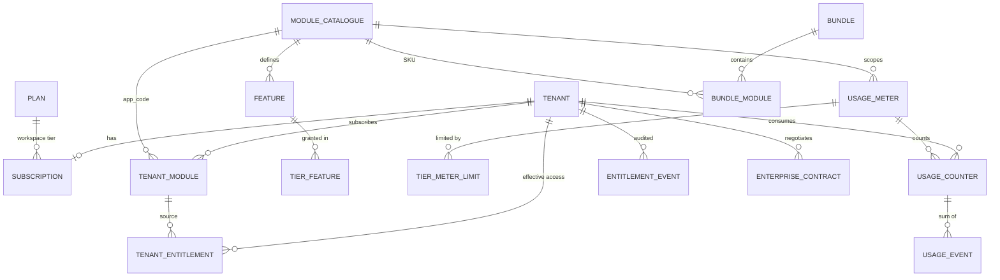

# Entitlement, subscription and usage architecture (target)

Principle: **reuse what works, remove duplicates, add only what the rules need.** Spring Modulith stays; no microservices; modules never read billing tables.

## 1. Entities
| Entity | Decision | Notes |
|---|---|---|
| `plans` (PlatformPlan) | **Keep, extend** | add tier_code, seat_limit (exists as `max_users`), storage_mb, api_calls, support_level, status, price book version |
| `module_catalogue` (Application) | **Keep, extend** | add `app_code` (canonical, unique, immutable), `commercial_class` (CORE, PAID, INTERNAL), `status` (LIVE, PILOT, HIDDEN), `qualifies_free_core`, `depends_on` (array), `package_name` |
| `tenant_modules` (ModuleSubscription) | **Keep as the one source of truth** | add `tier_code`, `period_start/end`, `renews_at`, `price_snapshot`, `bundle_id`. **Retire `module_subscriptions`** and the plan-JSON module booleans and `plan_modules` as entitlement sources |
| `features` | **New** | `feature_code`, `app_code`, name, category (CORE, ADVANCED, AUTOMATION, REPORTING, INTEGRATION, ENTERPRISE), status, `locks_never` flag (statutory/security: cannot be tier-locked) |
| `tier_features` | **New** | (app_code, tier_code, feature_code) |
| `usage_meters` | **New** | meter_code, scope (PLATFORM or app_code), unit, period (MONTH), enforcement (HARD, SOFT, REPORT), soft_overage_pct |
| `tier_meter_limits` | **New** | (tier_code or plan, meter_code, limit) and `tenant_meter_overrides` for contracts |
| `usage_events` | **New, append-only** | tenant_id, meter_code, source_type, source_id, event_type (ISSUE, ADJUST), quantity, occurred_at, **unique(tenant_id, meter_code, source_type, source_id, event_type)** (idempotency); trigger forbids update/delete |
| `usage_counters` | **New, materialised** | (tenant_id, meter_code, period_start) → used, limit_snapshot; the transactional gate |
| `tenant_entitlements` (TenantEntitlement) | **New, materialised** | one row per (tenant, app_code or feature_code or meter) with `source` (SUBSCRIPTION, TRIAL, DERIVED_FREE_CORE, PROMOTION, CONTRACT), `valid_from/to`, plus `tenant_entitlement_version` on the tenant |
| `entitlement_events` | **New, append-only** | every grant, revoke, extension, upgrade, downgrade, limit change with actor and reason (also feeds `access_audit_events`) |
| `admin_discounts`, `admin_volume_discounts`, `admin_partnerships` | **Keep** | later fold under `promotions` only if a second kind appears |
| `bundles`, `bundle_modules` | **New, phase E** | |
| `enterprise_contracts` | **New, phase G** | modules, limits, term, price |
| `module_prices` / price book versions | **New, phase E** | stop editing prices in place |
| `FeatureEntitlement` entity (unused) | **Retire** | |
| Trial table | **Not needed** | trial is a status and dates on `tenant_modules` |

## 2. ER diagram


## 3. Constraints
* `module_catalogue.app_code` unique and never renamed; keys used in code (`internal-audit`, `supplychain` vs `supply_chain`) are mapped once in a migration plus a unit test that every `requireModule` literal exists in the catalogue.
* `tenant_modules`: **unique (tenant_id, app_code) where status in (TRIAL, ACTIVE, PAST_DUE, CANCELLING)** (no double subscription, also under bundles).
* Every tenant-owned row carries `tenant_id` and a composite foreign key where it points at another tenant-owned row.
* `usage_events`: no update or delete (trigger, same pattern as `access_audit_events`).
* Counters and events written in the **same transaction** as the business action.
* Price snapshot, discount percent and source are stored on the subscription and never recomputed.

## 4. Computing effective entitlement
**Materialise, event-driven, versioned.** Compute on change, not per request.
1. Inputs: `tenant_modules` rows, trial dates, derived Free Core, active promotions, enterprise contract, tenant status, plan tier.
2. A single `EntitlementCalculator` (pure function, unit-tested) produces the set of modules, features and meter limits.
3. It runs when: a subscription is created, changed, cancelled, expires, or recovers from payment failure; a trial starts, extends or ends; a tier or contract changes; and by a nightly reconciliation that detects drift.
4. The result replaces the tenant's rows in `tenant_entitlements` and increments `tenant_entitlement_version` in one transaction.
5. `FeatureGuard`/`@RequiresModule`/`@RequiresFeature` read a cache keyed by (tenant, version). A version bump evicts it (in-process now; Redis or pub/sub only when there is more than one instance, which the scheduler design does not yet support).
6. Access tokens carry `tcv` (tenant entitlement version) and the filtered permission set (IAM roadmap Phase 1); a mismatch returns 401 `ACCESS_CHANGED` and the client refreshes. This closes the stale-permission window after a downgrade.

Dynamic calculation per request was rejected: four tables and a plan JSON per request, 109 scheduled jobs and 3,000 endpoints make it slow and hard to audit.

## 5. Module boundaries (Spring Modulith)
* `billing` owns subscription, entitlement, usage. It exposes a published interface package `billing.api` with: `EntitlementQuery.hasModule(tenant, appCode)`, `.hasFeature(...)`, `UsageGate.consume(tenant, meter, source, idempotencyKey)` and `UsageGate.remaining(...)`. Modules depend on these interfaces only, never on tables or `plans` JSON.
* Modules register themselves: an `AppDescriptor` bean (app_code, features, meters) discovered at startup and reconciled into the catalogue tables by a migration-checked sync, so a new module needs one class and one migration, not changes in billing.
* `invoicing` calls `UsageGate.consume` when it issues a document, inside its own transaction. It does not know pricing.
* Platform admin screens configure tiers, features, limits (rows, no code).
* The existing `billing → admin` coupling for discounts stays behind `DiscountFacade`; the `identity ↔ billing` cycle is to be removed by moving the tenant-created event to a shared package.

## 6. Transactional usage enforcement
```sql
-- inside the issuing transaction
INSERT INTO usage_events (...) VALUES (...) ON CONFLICT (idempotency columns) DO NOTHING;   -- 0 rows = already counted
UPDATE usage_counters SET used = used + 1
 WHERE tenant_id = ? AND meter_code = ? AND period_start = ? AND used < ?;                  -- ? = limit incl. soft overage
-- 0 rows updated => over the limit => throw LIMIT_REACHED, roll back the issue
```
The conditional update serialises concurrent issuers on one row, so two parallel requests cannot both take the last unit. Period rows are created lazily per billing month in Africa/Johannesburg. Soft cap: allow up to `limit * (1 + soft_overage_pct)`, flag the counter, and raise a `UsageLimitReached` event at 80/90/100%.

## 7. Domain events (published by `billing`, consumed by interested modules)
`SubscriptionCreated`, `SubscriptionActivated`, `SubscriptionChanged`, `SubscriptionCancelled`, `TrialStarted`, `TrialExtended`, `TrialExpired`, `PaymentFailed`, `PaymentRecovered`, `TenantSuspended`, `EntitlementGranted`, `EntitlementRevoked`, `UsageRecorded`, `UsageLimitReached`, `ModuleActivated`, `ModuleDeactivated`. Each carries tenant id, app code, effective date, actor and a correlation id; consumers (notifications, identity token filtering, audit) never read billing tables. Existing: `SubscriptionActivatedEvent`, `FeatureToggledEvent`.

## 8. Answers to the twelve questions
1. **Dynamic or materialised:** materialised, event-driven, with nightly reconciliation (section 4).
2. **Recalculation:** the calculator on every change event (section 4 step 3).
3. **Cache invalidation:** version bump per tenant; cache key includes version.
4. **Stale permissions after downgrade:** `tcv` claim, filtered token, 401 `ACCESS_CHANGED`; interim: report mode then enforcement via the interceptor, which checks entitlement on every request regardless of token.
5. **Register a new module:** one `AppDescriptor` bean plus a migration row; a test fails if a controller package has no registered app code.
6. **Feature catalogue per module:** declared in the descriptor, synced to `features`.
7. **Tiers:** rows in `tier_features`/`tier_meter_limits`; editable in the admin app.
8. **Transactional limits:** section 6.
9. **Grandfathering:** price snapshot and `price_book_version` on the subscription.
10. **History:** `entitlement_events` plus append-only `usage_events`.
11. **Propagation across modules:** Modulith application events (in-process), published interface for queries.
12. **Avoid coupling:** modules depend on `billing.api` only; billing never references module tables.

## 9. Free Core derivation (in the calculator)
```
paid = tenant_modules where status in (ACTIVE, PAST_DUE, CANCELLING or TRIAL-approved) and catalogue.qualifies_free_core
if paid is not empty  ->  grant {crm, invoicing, catalogue core features} with source DERIVED_FREE_CORE (one row each)
else                  ->  if tenant has no active transition: begin TRANSITION_READ_ONLY (30 days), emit entitlement events
```
One set of rows regardless of how many paid modules exist.
