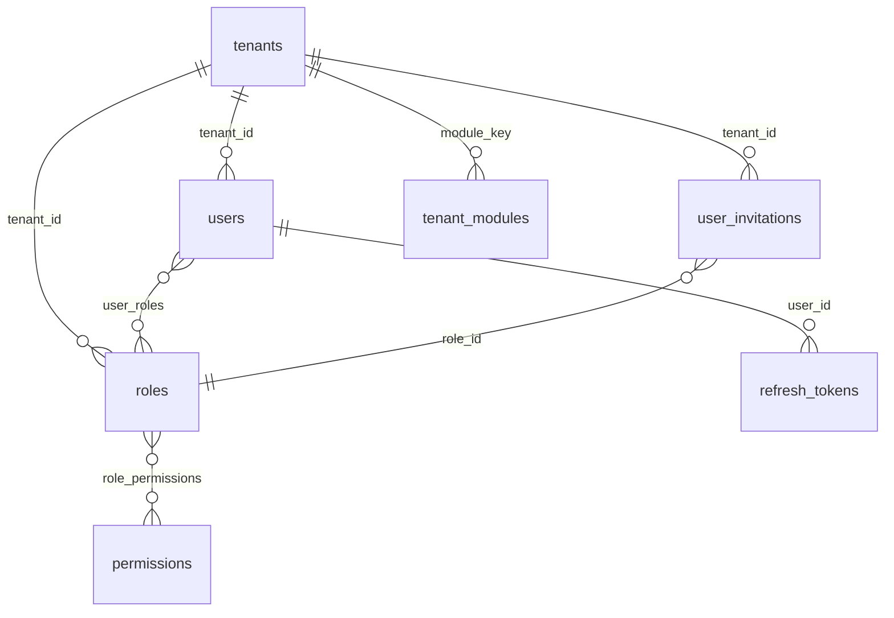
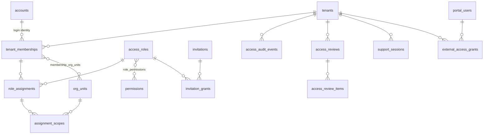

# HandyFlow – Target IAM Architecture (proposal)

Status: **proposal for approval.** Based on `USER_MANAGEMENT_AUDIT.md`. No code or migration has been written. Finding numbers (F1…F15) refer to that audit.

## 0. Recommendation in one paragraph

Build a **hybrid** model (Option C), **inside the existing `identity` Spring Modulith module** (no new microservice, no new top-level module). Identity owns *who* (accounts, tenant membership, lifecycle), *which module* (entitlement-aware access), *which role* (assignments with scope, expiry, grantor) and *the single permission engine*. Each business module only **declares** its permissions and role templates and **enforces** its own business rules (approvals, limits, maker-checker). One central User Management area is the only place users are invited and access is granted; modules get a read-only "who has access here" view plus a limited, bounded "manage this module's roles" action for module administrators. Small businesses see a simple mode (Owner plus a role per person); enterprises switch on departments, scopes, access reviews and separation-of-duties enforcement.

---

## 1. Centralised, module-specific, or hybrid

| | A: central only | B: each module | **C: hybrid (chosen)** |
|---|---|---|---|
| One answer to "who has access?" | Yes | No (30+ lists) | **Yes** |
| Module-specific permissions | Weak (a central team must know every module) | Strong | **Strong (modules declare their own)** |
| Consistent lifecycle (suspend, revoke, audit) | Yes | No: each module reimplements; leavers are missed | **Yes** |
| Duplicate permission engines | No | Yes (the exact risk you named) | **No** |
| Fit for a one-person business | Yes | Awkward (many screens) | **Yes (simple mode)** |
| Fit for an enterprise | Needs delegation | Delegation by default but no governance | **Yes** |

Option B fails on the evidence already in the repo: 58 permission-name prefixes, 10 separate portal grant tables, about 1,700 hand-written `requireModule` call sites, and no audit. Option A alone would make one team the bottleneck for every module's vocabulary. Option C keeps the **engine** central and the **vocabulary** local.

**Should module administrators manage users from inside their own module?** Yes, with hard boundaries:
- They act on the same central engine (the module screen calls the central API), so no second store exists.
- They can assign **only roles of their own module**, and only roles whose permissions are a subset of what they hold (no escalation, fixes F1).
- They can **invite** a person only into their module (the invitation carries just those grants) and can **revoke** their module grants; they cannot grant tenant-level roles, cannot touch another module, cannot change tenant owners or administrators, and cannot grant approval permissions unless the tenant policy marks that role "delegable".
- Every action is written to the access audit log with the module as context.

---

## 2. Administrative hierarchy

```
HandyFlow Platform  ── Platform Super Admin / Platform Support (admin module, own login + TOTP)
                       no standing access to tenant data; time-boxed support access only
─────────────────────────────────────────────────────────────────────────────────────
Tenant              ── Tenant Owner            (1..n, at least one always; ownership, billing, plan)
                    ── Tenant Administrator    (people and access; no business approvals by default)
                    ── Module Administrator    (one module; bounded delegation)
                    ── Department Manager      (operational + approvals only where assigned)
                    ── Standard User           (assigned responsibilities)
─────────────────────────────────────────────────────────────────────────────────────
External            ── Portal / external identities (customers, suppliers, accountants, auditors,
                       recruitment clients, attendees…) — NOT tenant members
```

| Role | Can | Cannot (by default) |
|---|---|---|
| **Platform Super Admin** | manage tenants, modules, subscriptions, platform config, platform audit, incidents | read or change tenant business data; approve anything in a tenant |
| **Platform Support** | open a **support session** on a tenant (reason, ticket, time limit, read-only; write only with tenant owner approval) | open a session silently; act outside the time limit |
| **Tenant Owner** | everything the Administrator can; subscription and billing; add/remove administrators; transfer ownership; approve high-risk access (grants of approval authority) | be removed or demoted while he or she is the last owner; approve their own sensitive transactions |
| **Tenant Administrator** | invite/suspend users, assign roles and module access (only what the tenant is entitled to and only up to their own authority), create custom roles, departments, run access reviews | approve payroll, pay suppliers, refund, reopen periods, export sensitive data (these are separate permissions, not implied) |
| **Module Administrator** | manage access and configuration inside one module (section 1 limits) | anything outside the module; grant above own authority |
| **Department Manager** | team-level operational permissions, approve within an approval limit if granted | manage users or roles |
| **Standard User** | the permissions of the roles assigned | see other users' permissions |

**Tenant Owner versus Tenant Super Admin versus Tenant Admin.** Two tenant-level types are enough. "Tenant Super Admin" and "Tenant Admin" would differ only in degree and would recreate today's all-powerful `ADMIN`. So: **Owner** (accountability for the account) and **Administrator** (runs access). Today's `ADMIN` role maps to Owner for the first user and to "Administrator (legacy, all permissions)" for others until the tenant runs its first access review (section 9).

**Ownership.** A tenant always has at least one active Owner (enforced the way the last-admin guard works today, but on the Owner role). Ownership can be transferred (two-step: the new owner accepts; the old owner is then demoted or kept as a second owner). An Owner is never removable by an Administrator.

**Administrative authority is not approval authority.** No built-in administrative role contains `*_APPROVE`, `AP_PAY`, `PAYROLL_*`, `INVOICE_REFUND`, `ACCOUNTING_PERIOD_REOPEN` or `*_SENSITIVE_READ`. An administrator can *assign* these to someone else but cannot use them unless they are also explicitly given them. Giving oneself an approval permission requires an Owner's confirmation and is logged.

---

## 3. Concepts that must stay separate

| Concept | Meaning | Where it lives (target) |
|---|---|---|
| **Entitlement** | what the tenant bought | `billing` (existing `tenant_modules`, `EntitlementService`) |
| **Access** | which people may enter a module | derived: an active role assignment on a role of that module |
| **Role** | a named bundle of responsibilities | `access_roles` + `role_permissions` |
| **Permission** | one action | `permissions` (with metadata) |
| **Data scope** | which records | `assignment_scopes` (branch, site, department, own) |

A request is allowed only if **all** hold: the account is active and a member of the tenant → the module is entitled and active → an assignment (not expired, not revoked) grants the permission → the data scope covers the record → the module's own business rule (approval limit, maker-checker) passes.

---

## 4. Data model

### 4.1 Current (from the repo)



### 4.2 Target



### 4.3 What happens to each table

| Table | Action |
|---|---|
| `users` | **Keep**, then split. Phase 2 adds `accounts` (global login: email, password hash, verified flag) and `tenant_memberships` (per tenant: status, joined, suspended by/at/reason). `users.id` stays as the membership id so every foreign key in 400+ tables keeps working. |
| `roles` | **Update**: add `module_key` (null = tenant-level), `system_key` (e.g. `OWNER`, `TENANT_ADMIN`, template keys), `is_system`, `template_version`, `delegable`. Rename concept to access role; the table can keep its name. |
| `permissions` | **Update**: add `module_key`, `resource`, `verb`, `sensitivity` (NORMAL / SENSITIVE / FINANCIAL), `read_only` (exists as `is_read_only`), `requires_second_person` (maker-checker), `grantable_by` (OWNER / ADMIN / MODULE_ADMIN). |
| `role_permissions` | **Keep**. |
| `user_roles` | **Replace** by `role_assignments` (adds grantor, grant time, expiry, reason, revocation). Backfill from `user_roles`. Keep `user_roles` as a read-only view during transition. |
| `user_invitations` | **Update** to `invitations`: `token_hash` instead of plaintext, `status` incl. EXPIRED/REVOKED/DECLINED, `resend_count`, `last_sent_at`, `accepted_by`. Grants move to `invitation_grants` (several modules and roles per invitation). |
| `refresh_tokens` | **Keep**. Add `membership_id` when memberships exist. |
| `tenant_modules` | **Keep** (billing owns it). Identity reads entitlement through a facade. |
| *new* `org_units` | departments, teams, branches, sites (tree, per tenant). |
| *new* `membership_org_units` | membership to unit. |
| *new* `assignment_scopes` | assignment to scope (ALL / OWN / UNIT list). |
| *new* `access_audit_events` | append-only, same trigger pattern as `audittrail` (V409). |
| *new* `access_reviews`, `access_review_items` | periodic reviews. |
| *new* `support_sessions` | formalise today's `AdminImpersonationSession` (add ticket, approver, scope, expiry). |
| *new* `external_access_grants` | one generic grant table to replace the ten portal-specific ones, **phased**: leave existing tables working. |
| *new* `delegations` | temporary hand-over of an assignment (from, to, window, reason). |

Constraints and indexes (proposed): unique `(tenant_id, account_id)` on memberships; unique `(tenant_id, system_key)` on roles; unique partial index on pending invitations `(tenant_id, lower(email)) WHERE status='PENDING'`; unique `token_hash`; indexes `(membership_id) WHERE revoked_at IS NULL` on assignments, `(tenant_id, created_at)` and `(tenant_id, target_membership_id)` on audit events; check `expires_at > granted_at`.

### 4.4 Flyway and compatibility strategy (expand, migrate, contract)

1. **Expand** (additive only): new columns nullable, new tables empty. Existing code keeps working.
2. **Backfill** in separate repeatable steps: permission metadata from a prefix map (reviewed by hand for the 332 names); roles to `module_key` where obvious; `user_roles` to `role_assignments`; `ADMIN`'s first user to `OWNER`.
3. **Dual write** for one release: new service writes assignments and the legacy `user_roles`; reads still legacy.
4. **Switch reads** behind a per-tenant flag; compare results in logs (shadow mode) before flipping.
5. **Contract** only after one full release and a tenant-by-tenant report of differences is clean.

Compatibility rules: no existing role loses a permission in the first release; new permissions stop being auto-granted to `ADMIN` **only for tenants that have completed an access review** (otherwise behaviour is unchanged); `users.id` never changes; the JWT keeps the `pz` claim so no controller needs to change.

---

## 5. Permission design standard

Keep the existing string style (`MODULE_RESOURCE_VERB`, upper case, underscores) so the 332 live names and 471 controllers do not need renaming. Add a **catalogue with metadata** and a **standard verb set**:

| Verb | Meaning |
|---|---|
| `READ` | view (list and detail) |
| `MANAGE` | create, update, soft-delete within the module (default write permission) |
| `APPROVE` | approve or reject a submitted item (checker) |
| `PAY` / `ISSUE` / `SIGN` / `PUBLISH` | irreversible or externally visible acts, only where the business act exists |
| `EXPORT` / `IMPORT` | bulk data out/in |
| `SENSITIVE_READ` | personal, medical, salary, banking details |
| `ADMIN` | configure the module and assign its roles (module administrator) |

Rules:
1. Every module has `READ`, `MANAGE`, `ADMIN` (three baseline). Anything more needs a reason in one of four classes: **approval** (maker-checker), **financial movement**, **sensitive data**, **bulk export**. Create, update and delete are **not** separate permissions unless delete is legally sensitive.
2. Target ≈ 6–10 permissions per module. Clinic (99 today) is the exception because of clinical sign-off and POPIA/HPCSA duties; it keeps its catalogue but gets the same metadata.
3. A permission carries its `module_key`; the engine derives module access from it, so a permission can never grant a module the tenant does not own.
4. Names are registered by the module (see section 8), not typed into controllers ad hoc. A test fails the build if a controller uses an authority that is not in the catalogue.

---

## 6. Role design

- **Predefined templates** (shipped, versioned, per module) such as *HR Officer*, *Payroll Preparer*, *Payroll Approver*, *Fleet Read-only*. Templates are copied into the tenant as system roles; the tenant can clone and edit a clone. Templates are listed in `MODULE_ROLE_PERMISSION_MATRIX.md` and are **proposed** unless marked implemented.
- **Custom roles**: yes, Administrators can create them (Decision 6), limited to permissions they hold or that are delegable, and not including any permission marked `FINANCIAL` or `SENSITIVE` unless an Owner confirms.
- **Multiple roles per user**: yes. Effective permissions are the **union**. There is no explicit deny, no role inheritance (explicit assignments are easier to explain and audit).
- **Conflict prevention**: a table of toxic pairs (e.g. `AP_MANAGE` + `AP_PAY`, `PAYROLL_PREPARE` + `PAYROLL_APPROVE`, `INVOICE_CREATE` + `CREDIT_NOTE_APPROVE`) is checked **when an assignment is made**. Enterprise mode blocks it; simple mode warns and lets the Owner acknowledge (recorded).
- **Direct user permission overrides: no.** They are the main source of unreviewable access. Exceptions are served by (a) a small custom role, (b) a time-limited assignment, (c) a delegation.
- **Departments, teams, branches and sites** do not grant permissions by themselves; they narrow **data scope** of an assignment (Decision 10).
- **Approval limits** are an attribute of the assignment (`approval_limit_amount`, currency ZAR), read by modules.

---

## 7. Evaluation and revocation

Hybrid, with an access version:

1. The JWT keeps `pz` (packed permissions) and gains `acv` (membership's access version) and `tcv` (tenant entitlement version).
2. Any change that affects a membership (role assigned or revoked, role edited, suspension, module entitlement change) **increments** its `acv` (tenant-wide changes increment `tcv`).
3. `JwtAuthFilter` compares the token's versions with an in-process cache (TTL ≈ 15 s, invalidated by an application event on the same node and by a short TTL on others). If stale it answers `401 ACCESS_CHANGED`; the client already knows how to refresh (`RefreshTokenService`), the refresh re-reads everything and issues a new token.
4. Suspension also revokes refresh tokens at the moment it happens (today it waits for the next refresh, F10).

Result: **revocations and suspensions bite within seconds** (cache TTL), grants within one refresh; the cost is one cache lookup per request and a database read once per TTL per active user. The 15-minute access token stays as the outer bound.

**Entitlement on tokens (fixes F2 without touching 471 controllers):** when a token is minted, permissions whose `module_key` is not entitled (and not core) are **dropped**; `tcv` forces re-mint when the tenant's modules change. In addition a Modulith/ArchUnit test requires every controller to either declare `@RequiresModule("x")` or be listed as core/public, and an interceptor enforces it. Both layers: the claim filter is the safety net, the annotation is the explicit contract.

**Subscription lifecycle:** subscribing grants nobody access (admin assigns). Cancelling hides the module and drops its permissions from tokens; **assignments are kept**, marked dormant. Resubscribing reactivates dormant assignments into a **pending review** state: the Owner sees them listed and confirms in one click (or "restore all"), rather than access silently coming back.

---

## 8. Package boundaries (Spring Modulith)

Stay inside `identity` (it already depends only on `shared` and, by documented exception, billing):

```
identity/
  api/           UserManagementController, InvitationController, RoleController, AccessReviewController, MyAccessController
  access/        AccessFacade (public, named interface): hasPermission, effective access, version lookup
                 PermissionCatalogue (SPI): ModulePermissionContributor beans registered by each module
  application/   invitation, membership, assignment, review, audit services
  domain/        entities above
```

Modules depend only on `identity.access` (`AccessFacade`, `PermissionCatalogue`, `SeparationOfDutiesPolicy`). Billing exposes entitlement through its existing facade; identity reads it, never the reverse beyond the already-accepted event.

**Why not a new `iam` module:** the existing cycle with billing is accepted and documented (see the comment in `AuthService`); splitting would force the redesign that comment calls "Q19-alt". Extend `identity` and split later if a second deployable ever exists.

---

## 9. Separation of duties and approvals

Enforced **centrally**: (a) toxic-pair detection at assignment time; (b) `SeparationOfDutiesPolicy.assertDifferentActor(makerId, checkerId, action)` used by every approve method; (c) a build-time rule that every method guarded by an `*_APPROVE`/`PAY`/`ISSUE` permission calls it; (d) approval limits read from assignments; (e) audit of every approval with the actor; (f) a "sole operator" acknowledgement for one-person tenants.

Enforced **by modules**: what "maker" and "checker" mean for their own documents (journal, supplier payment, payslip run, credit note, stock adjustment, fuel delivery, refund, contract), dual approval thresholds, conflict-of-interest rules (e.g. an employee cannot approve their own leave or expense). Existing examples to align with the central helper: `accounting/.../JournalReviewRules.java`, `ap/domain/model/ApBill.java`, `accounting/.../BankReconciliationService.java`, `facilitiesmanagement/.../FmWorkOrderService.java`, `supplychain/.../ScmService.java`, `catalogue/.../PricingRules.java`, and the `approvals/` engine for configurable multi-step flows.

---

## 10. Platform access to tenant data and support sessions

- **No standing access.** Super Admin manages tenants and plans; business data is out of reach by default.
- **Support session** (`support_sessions`): support staff request with a reason and ticket reference; the session token is **read-only** (reuses the `is_read_only` permission set from V287), expires (≤ 60 min, renewable once), is banner-labelled in the UI, notifies the tenant Owner by email, and is listed in the tenant's own audit view. Write actions need the Owner's approval in the product, scoped to one action type and time.
- Today's `AdminImpersonationSession` (reason, IP, 15-minute read-only token) is the foundation; add ticket, approver, tenant notification and tenant-visible log.
- **No password sharing, no "log in as user" with their credentials.**

## 11. External users

Not tenant members. They stay **portal identities** (global `portal_users`, separate secret and filter, already in place) with **explicit, scoped, expiring grants** per tenant and subject (client, engagement, project, tender). Customers, suppliers, event attendees and client-portal users: portal identity plus grant to the subject. Accountants, auditors, contractors, recruitment clients: portal identity plus time-boxed grant that the tenant can see and revoke in User Management ("External users" tab). Freelancers who work *inside* tenant screens (e.g. a contractor using HR tools) are the only external people who become tenant members, flagged `type = EXTERNAL`, with mandatory expiry. Phase later: unify the ten grant tables behind `external_access_grants`.

## 12. Security requirements (summary)

Tenant isolation: scoped finders only, automated test and ArchUnit rule (roadmap R-5). Escalation: grantor ceiling check on every grant. Token claims: add versions; keep short life. Invitation tokens: store hash, single use, expiry state, bind accept to the invited email, resend rotates the token. Mass assignment: request DTOs with explicit fields (already records); role/permission ids validated against the tenant and the grantor. Audit tamper resistance: append-only trigger, no update/delete grants for the application role. Service-to-service: internal facades only; no HTTP between modules.

---

# 13. The 18 decisions

Complexity: S small, M medium, L large. MVP = needed for the first release of the programme; Later = phased in.

| # | Question | Recommendation | Reason | Security | Business | Cx | MVP? |
|---|---|---|---|---|---|---|---|
| 1 | One central User Management page? | **Yes.** | Single answer to "who has access"; one lifecycle. | One place to review and audit; fewer missed leavers. | Simple for owners; reports in one spot. | M | MVP |
| 2 | Module-level user/permission pages? | **Only as embedded views of the central engine** (list, assign module roles, revoke) for module admins. No private stores. | Admins work where they are; no second engine. | Same checks and audit as central. | Delegation without chaos. | M | Later (read-only list in MVP) |
| 3 | Hybrid central IAM + module permissions? | **Yes.** | Section 1. | Central enforcement; local vocabulary. | Modules ship independently. | M | MVP |
| 4 | Owner / Super Admin / Admin / Module Admin? | **Owner** (accountable, billing, ownership), **Administrator** (people and access), **Module Admin** (one module). "Super Admin" is **platform only**. | Removes the ambiguous middle tier. | Smaller blast radius. | Clear language for customers. | S | MVP |
| 5 | Tenant admin unrestricted across modules? | **No.** Admin gets access only to modules and roles granted; none of the approval/financial/sensitive permissions by default. Legacy `ADMIN` keeps today's rights until the first access review. | Admin ≠ approver. | Removes F5. | Needs a migration message to existing customers. | M | MVP (new tenants), Later (legacy) |
| 6 | Admins create custom roles? | **Yes, bounded**: only permissions they hold or that are delegable; financial/sensitive ones need Owner confirmation. | SMEs need their own job titles. | Closes F1 on role edit. | Flexibility without tickets. | M | MVP |
| 7 | Predefined module role templates? | **Yes**, versioned, copied into tenant, clonable. | Fast onboarding; consistent. | Reviewed least-privilege bundles. | Fewer decisions for small firms. | M | MVP (core modules), Later (rest) |
| 8 | Multiple roles per user? | **Yes**, union, no deny, no inheritance. | One person, many hats in an SME. | Toxic-pair check at assignment. | Matches reality. | S | MVP |
| 9 | Direct permission overrides? | **No.** Use custom role, time-limited assignment, or delegation. | Overrides are unreviewable. | Fewer hidden grants. | Slightly more clicks for odd cases. | S | MVP |
| 10 | Departments, teams, branches affect access? | **Yes, for data scope only** (ALL / OWN / unit list), never for permissions. | Real multi-branch businesses need it. | Limits data exposure. | Enterprise feature, hidden in simple mode. | L | Later |
| 11 | Module admins manage their module users? | **Yes**, within section 1 boundaries. | Practical delegation. | Ceiling check, module-bound, audited. | Reduces owner workload. | M | Later |
| 12 | External and portal users? | **Separate identities, scoped expiring grants**, visible centrally. | Different trust level and lifecycle. | Isolation from staff tokens (already separate secret). | One view for owners. | M | Later (central view), MVP unchanged |
| 13 | Subscription changes and access? | **Subscribing grants nobody access; cancelling drops permissions from tokens and keeps assignments dormant; resubscribing needs Owner confirmation.** | No silent access; no lost configuration. | Entitlement on tokens plus controller contract. | Predictable billing behaviour. | M | MVP |
| 14 | Immediate revocation? | **Access version + short cache + refresh-token revoke on suspend** (≈ seconds). | Pure DB-per-request is costly; token-only is slow. | Closes F10. | "Remove access" really means now. | M | MVP |
| 15 | Stop admins approving own sensitive transactions? | **Central `assertDifferentActor` + build rule + admin roles without approval permissions + approval limits.** | Single rule, many modules. | Closes the F5 gap. | Sole operators acknowledge once. | M | MVP (helper + AP/payroll/journal), Later (all) |
| 16 | Platform Super Admin sees tenant data? | **No, not by default.** | Trust and POPIA. | Smaller insider risk. | A selling point for enterprises. | S | MVP |
| 17 | Temporary support access / impersonation? | **Support sessions**: reason, ticket, ≤ 60 min, read-only, tenant notified and able to see it; write needs Owner approval. | Support is needed; accountability required. | Time-boxed, audited. | Builds trust. | M | MVP (notify + log), Later (write approval) |
| 18 | Access reviews for enterprises? | **Optional periodic review** (quarterly default), reviewer sees users × modules × roles, confirms or revokes, exceptions recorded; reports in `USER_MANAGEMENT_UX_SPEC.md`. | Audit requirement for larger firms. | Removes stale access. | Off by default for small tenants. | M | Later |

## 14. What must not change

Existing tenants, users, roles, and subscriptions keep working through every phase. No permission is renamed. No token format break. No data deleted. Each phase has a rollback (turn the per-tenant flag off).

---

# 15. Decisions confirmed on 2026-11-04

## 15.1 Free entry tier and paid upgrades (answers "which modules are free")

- **Free entry tier:** CRM, Invoicing (with a cap on quotes and invoices) and Catalogue are available to every tenant without a subscription row.
- **Paid upgrades:** further features of those modules, and every other module, need an entitlement.
- Consequence for the design: entitlement is **module + tier + usage limits**, not just module on/off. `billing` already has `FeatureGuard.requireFeature(featureKey)` and `EntitlementService.isFeatureEnabled`; the free tier is expressed as a plan whose included features and limits are explicit data (for example `invoicing.documents_per_month`, `crm.advanced_*`), and the permission-claim filter (section 7) uses the module key only; feature and limit checks stay in `billing` and are called by the module's service (`requireFeature`, `requireWithinLimit`).
- **Gap found:** nothing in the code limits quotes or invoices today (I searched for per-tenant invoice or quote caps and found only seat limits, `plans.max_users`). The free-tier cap must be built; it is not an existing control. Which features of CRM, Invoicing and Catalogue count as "more features" is a product list I still need from you (for example: recurring invoices, credit notes, multi-currency, price lists, imports).
- Core modules still appear in the controller coverage test as "free, allow-listed"; every other module without a guard is a bug.

## 15.2 Owner/Administrator split: approved

## 15.3 Sole-user and very small businesses

Yes, they are accommodated by design, and nothing in the Owner/Administrator split adds steps for them.

1. **One person is the Owner and everything else.** Registration creates one Owner membership. The Owner holds the administration permissions **and** all business permissions of the modules the tenant is entitled to (including approvals). There is no "invite yourself" step, no role choice, no matrix. *People & Access* shows one row and an *Invite someone* button.
2. **Separation of duties applies only when there is someone to separate from.** The rule "a person cannot approve their own transaction" is enforced when **another active member holds the checking permission**. If nobody else could check it, the maker may approve it. The approval is stored with `self_approved = true` (reason "sole approver") and is listed in a report the Owner can hand to an accountant or auditor. Nothing is blocked, nothing is hidden.
3. **It switches itself on as the business grows.** When a second active person is given an approval permission, the rule starts to apply for that permission from that moment; the Owner sees a one-time message explaining it. A two-person business (Owner plus a clerk without approval rights) works naturally: the clerk's items are approved by the Owner; the Owner's own items can still be self-approved and are flagged.
4. **Optional strictness.** An advanced switch, *Always require a second approver*, turns the exception off for tenants that want it (needs at least two approvers to work, and warns if not).
5. **Lock-out protection.** The only Owner cannot be suspended, removed or demoted; they can transfer ownership to another person. Account closure is a separate, deliberate flow.
6. **Seats.** A sole user uses one seat. The free tier's seat limit is read from the plan (`plans.max_users`, default 5 today).
7. **External helpers.** An outside accountant or bookkeeper is invited as an external (portal) user with a time-boxed grant; they never use a seat or become an Administrator.

## 15.4 Not yet in production

The project is in development with no live customers, so the compatibility machinery in section 4.4 is **not needed**. Changes below replace it (details in the roadmap): migrate directly instead of expand/dual-write/contract; rename tenant permissions to the new names in one go; convert today's `ADMIN` role straight into Owner (first user) and Administrator; enforce entitlement immediately; reseed development and test databases instead of backfilling. The target data model and the 18 decisions are unchanged.
